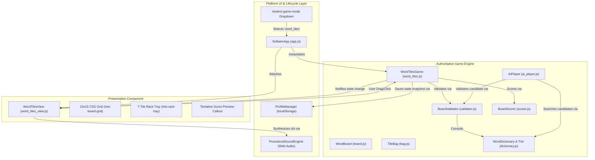

# Word Tiles: Sovereign Lexicon — System Architecture & Integration

## 1. Architectural Overview

Word Tiles is designed as an isolated, cleanly separated turn-based game engine integrated natively into the **Solitaire Sovereign** casual game platform.



---

## 2. Engine and UI Separation

The engine (`src/core/word_tiles/` and `src/games/word_tiles.js`) has **zero DOM dependencies**. It runs identically in Node.js automated test environments and inside the browser main thread:

- **Authoritative Invariants:** The UI component (`WordTilesView`) never calculates scores or determines move legality. All validations pass through `BoardValidator.validateMove()` and all scores are computed by `BoardScorer.calculateScore()`.
- **Atomic State Mutations:**
  - Placed tiles remain in `temporaryPlacements` array until committed.
  - An invalid move can never corrupt committed board cells, deplete the tile bag, or advance turn ownership.
  - When validation fails, the UI displays clear, plain-language error toasts while maintaining the editable temporary board state.
- **Strict Tile Conservation:**
  - The `TileBag.verifyConservation()` invariant checks:
    $$\text{Bag} + \text{Human Rack} + \text{AI Rack} + \text{Board} + \text{Temp Placements} = 100 \text{ tiles}$$
  - Any duplicate tile, lost tile, or phantom allocation immediately throws an assertion error.

---

## 3. License-Verified Lexicon & Prefix Trie (`dictionary.js`)

- **Dual-Representation Indexing:**
  1. **JavaScript `Set<string>`:** Provides instant $O(1)$ exact word existence queries during move validation.
  2. **26-Branch Prefix Trie (`TrieNode`):** Enables depth-first prefix pruning during computer opponent move search. If a 3-letter sequence like `"XZQ"` does not exist in the Trie, all deeper branches are pruned in $O(1)$ time.
- **Asynchronous Preloading with Resilient Fallback:**
  - On application startup, the platform synchronously loads a curated seed lexicon (~1,000 common valid words) so offline unit tests and instant gameplay never block.
  - Simultaneously, it issues a non-blocking background `fetch('/assets/dictionary/enable1.txt')` to ingest the full 172,823-word Public Domain ENABLE1 lexicon.

---

## 4. Fair Computer Opponent AI (`ai_player.js`)

- **Non-Cheating Search Invariant:**
  - The AI algorithm inspects **only** its own rack of 7 tiles, the committed board cells, and the dictionary Trie.
  - It has zero visibility into the human player's rack and cannot inspect or predict future tile bag order.
- **Authoritative Engine Sharing:**
  - The AI does not employ a separate rule approximation. Every candidate move generated is run through the exact same `BoardValidator` used for human players.
- **Configurable Difficulty Tiers:**
  - **Easy:** Selects valid moves from the lower 35% scoring bracket (lengths 2–3, casual pacing).
  - **Medium:** Selects balanced moves from the 40th–65th percentile.
  - **Hard:** Evaluates all legal moves found within the search time budget and executes the highest-scoring play.
- **Time Budget & Cooperative Cancellation:**
  - A strict search budget (default 1,500ms) prevents UI thread freezing.
  - A `cancelToken` is checked on every recursive Trie step. If the user navigates away or resets the game, the search terminates instantly.

---

## 5. Platform Integration Points

### Game Mode Selector (`index.html`)
- Registered under `#select-game-mode` with value `word_tiles`:
  ```html
  <option value="word_tiles">Word Tiles (Turn-Based Board)</option>
  ```

### Viewport & DOM Hierarchy
- Embedded inside `#card-table` alongside existing game views:
  ```html
  <div id="word-tiles-view" class="word-tiles-container hidden"></div>
  ```

### Lifecycle & Persistence (`SolitaireApp` & `ProfileManager`)
- **Atomic Persistence:** Serializes board coordinates, tile IDs, bag order, rack contents, and move history into `solitaire_sovereign_saves_v1_{userId}_word_tiles`.
- **Seamless Resume:** Full deserialization restores exact board state, tile identity conservation, and turn status.
- **Stats Tracking:** Integrated into `ProfileManager` profiles under `gameStats.word_tiles: { played, won, highScore, bestScore }`.
- **Acoustic Sound Synthesis:** Reuses platform's `ProceduralSoundEngine` Web Audio API (tactile card snap for tile drops, slide for recalls, shuffle for reordering, success chimes for completed words).
