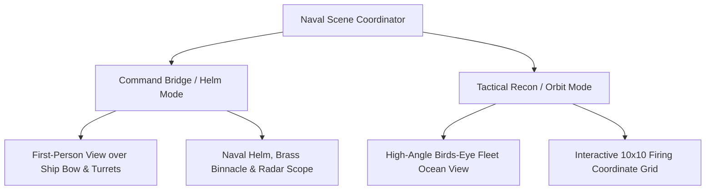
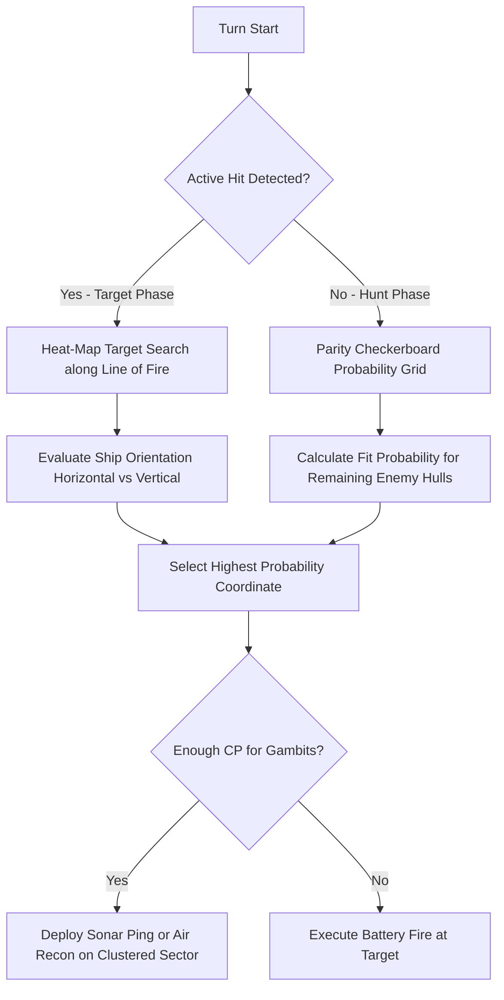

# Admiral's Gambit: Iron Fleet — Game Architecture & Technical Specification

> **A Provably Original, Clean-Room 3D Naval Combat Strategy Experience**  
> *Combines classic hidden-grid naval tactics with Command Point Gambits, 3D Command Bridge Viewport, Dynamic Gerstner Ocean Simulation, and Procedural Warship Fleet Combat.*

---

## 1. Executive Summary & Legal Clean-Room Foundation

### 1.1 Historical & Legal Ancestry
*Admiral's Gambit* is an original naval strategy game drawing upon the historical, public-domain mechanics of pencil-and-paper naval grid games (specifically the 1931 public-domain game *Salvo* and World War II naval tactical plotting boards). In accordance with [`docs/LEGAL_AND_CLEAN_ROOM_SPEC.md`](file:///d:/solitaire/docs/LEGAL_AND_CLEAN_ROOM_SPEC.md), *Admiral's Gambit* contains **zero proprietary assets, code, or copyrighted trade dress** from commercial adaptations (e.g. Milton Bradley/Hasbro *Battleship*):

| Domain | Public Domain / Mathematical Concept | Proprietary / Quarantined Expression | *Admiral's Gambit* Clean-Room Implementation |
|---|---|---|---|
| **Grid Representation** | 10×10 coordinate naval tracking grid (A–J, 1–10). | Plastic pegboards, proprietary peg molds, specific board dimensions. | Dual-channel digital tactical radar display with coordinate telemetry and range-bearing readouts. |
| **Fleet Types** | Standard naval vessel classifications (Carrier, Battleship, Cruiser, Destroyer, Submarine). | Specific toy ship molds, proprietary plastic colors, licensed ship names. | Procedural 3D low-poly naval vessels with functional swiveling gun turrets, radar arrays, and dynamic water wakes. |
| **Firing & Hit Rules** | Coordinate strike resolving as Hit or Miss. | "You sunk my battleship!" audio/text, red/white pegs. | Multi-tier Damage Model (Armor deflection, Compartment flooding, Secondary magazine cook-offs, Listing hull states). |
| **Tactical Depth** | Pure guessing / parity checkerboard search. | Fixed single-shot turns without tactical choice. | **Command Point (CP) Gambits**: Air Reconnaissance, Sonar Ping, Smoke Screens, Depth Charge sweeps, and Torpedo spreads. |

---

## 2. Core Game Rules & Mechanics

### 2.1 Fleet Classes & Specifications
Both the Player and the AI Admiral deploy a balanced 5-ship fleet across an authoritative 10×10 oceanic theater:

```
+-----------------------------------------------------------------------------------+
| SHIP CLASS           | CODES | SIZE | ARMOR / HP | SPECIAL TACTICAL GAMBIT        |
+----------------------+-------+------+------------+--------------------------------+
| Aircraft Carrier     |  CV   |  5   |    5 HP    | Air Reconnaissance (3x3 Scan)  |
| Battleship           |  BB   |  4   |    4 HP    | Heavy 16-Inch Battery (2 Hits) |
| Guided Missile Cruiser| CA   |  3   |    3 HP    | Radar Pulse (Row/Col Sweep)    |
| Fast Destroyer       |  DD   |  3   |    3 HP    | Depth Charge / Torpedo Line    |
| Attack Submarine     |  SS   |  2   |    2 HP    | Silent Running (Radar Stealth) |
+-----------------------------------------------------------------------------------+
```

### 2.2 Command Points (CP) & The "Gambit" System
Classic naval grid games suffer from deterministic, repetitive "hunt-and-target" parity loops. *Admiral's Gambit* introduces an asymmetric tactical resource: **Command Points (CP)**.

- **Turn Energy**: Admirals start each turn with **3 Command Points (CP)**.
- **Base Actions**:
  - `Main Battery Fire` (Cost: 1 CP): Fires a single high-explosive shell at designated coordinate $(X, Y)$.
- **Tactical Gambits**:
  1. ✈️ **Air Recon Sweep** (Cost: 2 CP, Requires Carrier alive):
     Scouts a $3 \times 3$ grid sector via carrier-launched scout plane. Reports whether *any* enemy vessel is present in the sector without dealing damage.
  2. ⚓ **Heavy 16-Inch Salvo** (Cost: 3 CP, Requires Battleship alive):
     Fires a devastating twin-shell salvo hitting target $(X, Y)$ and an adjacent cell simultaneously.
  3. 📡 **Surface Radar Sweep** (Cost: 2 CP, Requires Cruiser alive):
     Sweeps an entire row or column; returns count of ship hulls detected along that navigational axis.
  4. 🌊 **Depth Charge Line** (Cost: 2 CP, Requires Destroyer alive):
     Drops a line of 3 depth charges across adjacent cells, automatically uncovering and damaging any submerged Submarine.
  5. 💨 **Tactical Smoke Screen** (Cost: 2 CP):
     Deploys a dense $2 \times 2$ thermal smoke cloud over friendly waters, blocking enemy radar detection and visual targeting in that zone for 2 turns.
  6. 🦈 **Silent Running** (Passive Submarine Trait):
     The Submarine is invisible to standard radar sweeps and air recon until hit or detected by active Sonar/Depth charges.

### 2.3 Provably Fair Seed Generation
Fleet deployment is governed by our clean-room SplitMix64 PRNG:
- Seed format: `ADM-[BASE32-8CHAR]` (e.g. `ADM-K9X2M4VP`).
- Players can replay identical tactical fleet layouts or share seeds with friends for duplicate tournament play.

---

## 3. 3D Bridge Viewport & Ocean Rendering Architecture

### 3.1 Dual Viewport System


#### Mode 1: 🎯 First-Person Command Bridge Viewport
- **Armored Bridge Interior**:
  - Weathered steel bulkhead window frames with wiper blades and ocean spray droplets.
  - Brass compass binnacle and engine telegraph levers on the helm console.
  - Glowing green P-7 phosphor circular radar CRT displaying active sweep arm and detected blips.
- **Exterior Bow & Gun Turrets**:
  - Forward deck pitching and rolling over the ocean swell.
  - Main 16-inch triple gun turret swivels and elevates dynamically toward the player's selected coordinate before firing!

#### Mode 2: 🔭 Tactical Orbit / Reconnaissance View
- Free-orbit tactical camera with smooth damping (`OrbitControls`).
- Unrestricted high-angle tactical view of both naval zones, the fleet formation, and rolling ocean swells.

---

### 3.2 Dynamic Gerstner Wave Ocean Shader (`OceanWaterShader.js`)
Instead of a flat plane, the ocean is rendered via a custom WebGL2 GLSL shader:
1. **Multi-Octave Gerstner Wave Equations**:
   $$\vec{P}(x, z, t) = \sum_{i=1}^{4} \begin{pmatrix} Q_i A_i D_{i,x} \cos(\vec{D}_i \cdot \vec{x} \omega_i + \phi_i t) \\ A_i \sin(\vec{D}_i \cdot \vec{x} \omega_i + \phi_i t) \\ Q_i A_i D_{i,z} \cos(\vec{D}_i \cdot \vec{x} \omega_i + \phi_i t) \end{pmatrix}$$
   Generates realistic, sharp wave crests and broad troughs with pitching foam.
2. **Depth Absorption Gradient**:
   Color transitions from vibrant turquoise shallow coastal hues (`#0ea5e9`) to deep, abyssal navy blue (`#030712`).
3. **Sun Glint & Specular Highlights**:
   Blinn-Phong specular glints reflecting the sun disc across wave facets.
4. **Hull Foam Wakes**:
   Dynamically generated white foam rings and displacement wakes around stationary and moving warships.

---

### 3.3 Procedural 3D Warship Models (`WarshipMeshFactory.js`)
All naval vessels are modeled via clean, lightweight procedural geometries for high-performance 60 FPS rendering:
- **Aircraft Carrier (CV)**: Extended angled flight deck with runway markings, arresting cables, island superstructure, and parked F4U Corsair / jet fighter silhouettes.
- **Battleship (BB)**: Heavy armored citadel, dual forward & single aft triple-gun turrets that track targets, secondary 5-inch mounts, lattice radar masts, and dual smoke stacks.
- **Cruiser (CA)**: Sleek hull, raked funnels, dual twin-gun turrets, and rotating radar antenna.
- **Destroyer (DD)**: Flush-deck destroyer with twin forward turrets, midship torpedo tube mounts, and aft depth-charge launching racks.
- **Submarine (SS)**: Streamlined cigar hull, streamlined conning tower with periscopes, dive planes, and bronze propeller screws.

---

### 3.4 Cinematic Ballistics & Naval VFX
1. **Artillery Trajectory**:
   - Cannon fires with a massive orange muzzle blast, billowing propellant smoke ring, and dynamic flash light.
   - 16-inch armor-piercing projectile arcs gracefully across the sky with a glowing red tracer wake.
2. **Water Geyser Splashes (Miss)**:
   - Upon water impact, a towering 20-meter water geyser erupts upwards.
   - Cascading water droplets, foam rings, and expanding circular ripple waves propagate across the ocean surface.
3. **Catastrophic Shell Impacts (Hit)**:
   - Heavy metal impact flash, fiery explosion fireball, flying armor plating fragments, and billowing black fuel oil smoke.
4. **Sinking Vessel Physics (Sunk)**:
   - When a ship reaches 0 HP, catastrophic internal ammo magazine explosions rip through the hull.
   - The vessel lists 35° to port or starboard, bow points skyward, and it slowly slips beneath the foaming waves with bubbling cavitation particles.

---

## 4. Heuristic AI Admiral Engine (`AIAdmiralEngine.js`)

Unlike trivial random-guess bots, the AI Admiral operates on a multi-phase probabilistic tactical engine:


1. **Hunting Phase (Parity Algorithm)**:
   - Evaluates remaining player ships. If the smallest surviving ship is length 2, the AI targets cells on a checkerboard grid $(x + y) \equiv 0 \pmod 2$, strictly preventing wasted shots on impossible locations.
2. **Probability Heat Mapping**:
   - Computes a dynamic 2D weight matrix across all unrevealed cells by testing every possible orientation of every remaining ship hull. Cells with the highest superposition score are prioritized.
3. **Targeting Phase (Kill Streak)**:
   - Once a hit is registered, the AI isolates the axis (horizontal vs vertical) and systematically walks the line until the vessel is confirmed sunk.
4. **Gambit Counter-Strategy**:
   - The AI uses its Command Points intelligently: launching Air Recon over high-entropy sectors, using Radar Sweeps to narrow down carrier locations, and dropping Depth Charges when hunting the submarine.

---

## 5. Software Architecture & File Layout

```
d:/solitaire/
├── src/
│   ├── core/
│   │   └── admirals_gambit/
│   │       ├── rules_config.js         # Ship definitions, gambit costs, grid constants
│   │       ├── naval_grid.js           # 10x10 grid state, coordinate math, line-of-sight
│   │       └── ai_admiral_engine.js    # Probability heat-map & parity AI engine
│   ├── games/
│   │   └── admirals_gambit.js          # Authoritative game state machine & turn loop
│   ├── renderer/
│   │   └── naval/
│   │       ├── OceanWaterShader.js     # Gerstner wave displacement & water shader
│   │       ├── WarshipMeshFactory.js   # Procedural 3D warship models & turrets
│   │       ├── NavalBridgeRig.js       # First-person bridge interior, binnacle & radar
│   │       ├── NavalVFXManager.js      # Water geysers, muzzle fire, explosions, smoke
│   │       └── NavalSceneCoordinator.js# Three.js viewport coordinator & camera modes
│   └── ui/
│       ├── admirals_gambit_view.js     # Radar UI, bridge controls, CP meter, action log
│       └── components/                 # Tactical HUD widgets
└── tests/
    └── test_admirals_gambit.js         # 100% automated clean-room invariant test suite
```

---

## 6. Implementation Checklist & Phased Roadmap

- [x] **Phase 1: Architecture & Technical Specification**
  - [x] Clean-Room Specification and Legal Provenance validation
  - [x] Command Point Gambit game design and fleet specs
  - [x] 3D bridge viewport and Gerstner ocean architecture specification
- [ ] **Phase 2: Core Naval Combat Engine & Invariant Tests**
  - [ ] Implement `src/core/admirals_gambit/rules_config.js`
  - [ ] Implement `src/core/admirals_gambit/naval_grid.js`
  - [ ] Implement `src/core/admirals_gambit/ai_admiral_engine.js`
  - [ ] Implement `src/games/admiral_gambit.js`
  - [ ] Write unit tests `tests/test_admirals_gambit.js` verifying 100% rule invariants
- [ ] **Phase 3: 3D Ocean Shader & Warship Mesh Factory**
  - [ ] Implement `OceanWaterShader.js` with multi-octave Gerstner waves and foam
  - [ ] Implement `WarshipMeshFactory.js` for CV, BB, CA, DD, SS with swiveling turrets
  - [ ] Implement `NavalVFXManager.js` (towering water geysers, muzzle flash, explosions, oil fires)
- [ ] **Phase 4: 3D Command Bridge Rig & Scene Coordinator**
  - [ ] Build First-Person Bridge Rig (brass binnacle, helm, glowing radar scope, periscope viewport)
  - [ ] Implement `NavalSceneCoordinator.js` with Cockpit Bridge & Tactical Orbit camera modes
- [ ] **Phase 5: UI & Full Suite Integration**
  - [ ] Build `src/ui/admirals_gambit_view.js` with dual radar tactical maps and Gambit action cards
  - [ ] Add `#select-game-mode` entry in `index.html`
  - [ ] Verify 60 FPS performance and zero console errors in browser
